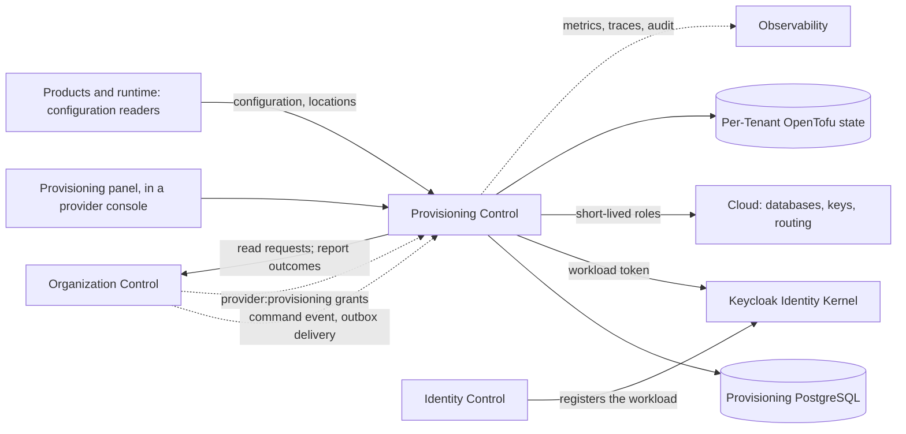
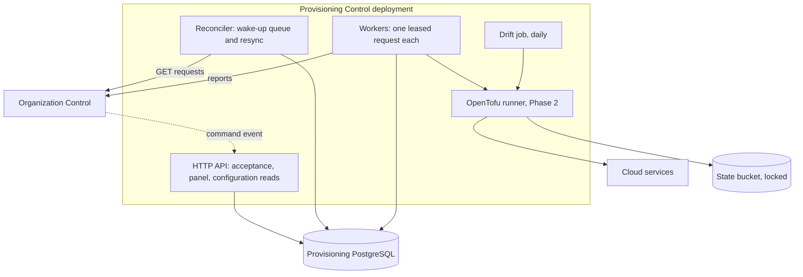
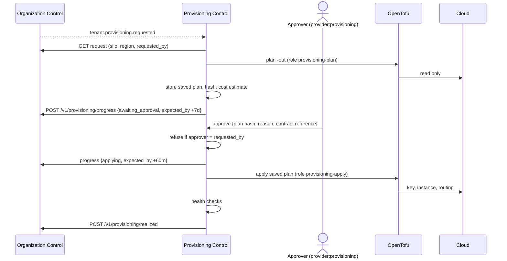

---
doc_meta:
  id: SAD-021
  title: Scnehaux Provisioning Control
  owner: Platform Engineering
  version: 1.1.0
  status: proposed
  classification: public
  governed_by:
    - GDC-009
    - ADR-PRV-001
  review_cycle_days: 90
  created_date: 2026-11-04
  last_reviewed: 2026-11-04
  parent_pad: PAD-PLT-017
---

# Scnehaux Provisioning Control

## 1. Purpose & Scope

### Objective

Realise `PAD-PLT-017` with one service that turns each provisioning request from Organization Control into realised infrastructure and configuration, and reports the outcome, with no person reporting `realized` in normal operation, in production or in development.

### Capability

- reads outstanding provisioning requests and reconciles them (`ADR-PRV-001`);
- builds pooled Tenants directly and dedicated Tenants through approved OpenTofu plans (`ADR-PRV-003`);
- runs each profile's health checks before it reports (`PAD-PLT-017 §3.4`);
- holds dedicated plans for approval (`ADR-PRV-002`);
- deprovisions in three stages and destroys by key (`ADR-PRV-005`);
- detects drift;
- serves the provisioning panel for failed, stuck and waiting requests (§5.5).

### Requirement

Replace `scripts/dev-provisioning.ps1` and `scripts/dev-deprovisioning.ps1` as the source of provisioning outcomes, first in development (Phase 1, pooled), then for every profile (Phase 2), before the first non-pooled Tenant.

### Constraint

- Go is the application language; PostgreSQL is the service's store (`ADR-PRV-003`).
- It shares no database with Organization Control and Organization Control holds none of its cloud credentials (`ADR-PRV-004`).
- It authenticates as its own registered workload (`ADR-ORG-001 §5.11`).
- Desired state comes only from Organization Control.
- The running development deployment keeps `dev-provisioning.ps1` until Phase 1 is merged and the owner redeploys.

### Assumption

- Organization Control serves the Phase 1 additions of §7.1 before this service's Phase 1 runs.
- Production runs on the adopted cloud and Kubernetes, with workload identity to cloud roles.
- The provider grant model of `ADR-ORG-002` can be extended to `provider:provisioning`.

### Out of Scope

- Tenant lifecycle, activation, offboarding obligations and retirement (`SAD-004`);
- Product data and its deletion in shared stores;
- the shared platform's clusters, networks and shared databases;
- the user interface of the panel, which is built in the console that hosts it (§5.5, open question 8).

## 2. Enterprise Traceability

### Realizes

This system realises `PAD-PLT-017` and the decisions `ADR-PRV-001` to `ADR-PRV-005`.

It inherits:

- the request and report contract from `SAD-004 §7.5` and `ADR-ORG-001 §5.11`;
- the provider grant model from `ADR-ORG-002`;
- per-consumer outbox delivery from `ADR-GLB-016` and `ADR-GLB-018`;
- environments, images and scripts from `STD-GLB-009`;
- retention from `STD-GLB-007`.

## 3. Solution Context

### System Context



### External

- Organization Control (`SAD-004`): requests, command event, grants, legal-hold flag, reports.
- Identity runtime (`SAD-001`): the service's workload client and the tokens of people using the panel.
- The cloud's database, key, secret and routing services.
- Products and runtime systems that read configuration and resource locations.

### Internal

1. **Provisioning Control application**: Go service with an HTTP API, the reconciler, workers, the drift job and the panel API.
2. **Provisioning PostgreSQL**: requests, plans, steps, leases, approvals, holds, configuration records, audit outbox.
3. **OpenTofu runtime**: the pinned binary and modules inside the service image, run in an isolated working directory per job (Phase 2).

## 4. Architecture Model

### 4.1 Container Architecture



### 4.2 Modules

| Module        | Responsibility                                                         |
| :------------ | :--------------------------------------------------------------------- |
| `intake`      | accepts the command event; enqueues a hint; never acts on the payload  |
| `reconcile`   | resync, request records, leases, deadlines                             |
| `profile`     | the plan of steps for each profile and each operation                  |
| `pooled`      | configuration and quota writes and their checks                        |
| `infra`       | OpenTofu plan, apply, drift; working directories; state (Phase 2)      |
| `health`      | the health checks of `PAD-PLT-017 §3.4` and `ADR-PRV-005 §5.3`         |
| `approval`    | plans awaiting approval, decisions, expiry (Phase 2)                   |
| `deprovision` | the three stages, holds, destruction (`ADR-PRV-005`)                   |
| `report`      | reports to Organization Control, resent until answered                 |
| `authority`   | workload authentication; projected `provider:provisioning` grants      |
| `config`      | configuration records and quota limits; reads for Products and runtime |

### 4.3 API Surface

```text
Organization Control only (its workload token)
POST /v1/deliveries                                  command event; answers 2xx once stored

Provider with provider:provisioning in force, X-Administrative-Reason required
GET  /v1/requests                                    ?state=&profile=&operation=&after=&limit=
GET  /v1/requests/{provisioning_request_id}
POST /v1/requests/{provisioning_request_id}/retry    a step-level retry inside the service
POST /v1/requests/{provisioning_request_id}/fail     report failed with a cause from the list
POST /v1/requests/{provisioning_request_id}/cleanup  remove what a failed build left
POST /v1/requests/{provisioning_request_id}/approve  Phase 2; plan hash and contract reference required
POST /v1/requests/{provisioning_request_id}/reject   Phase 2
POST /v1/tenants/{tenant_id}/destruction/hold        Phase 2
POST /v1/tenants/{tenant_id}/destruction/release-hold Phase 2

Registered configuration readers (workload tokens)
GET  /v1/tenants/{tenant_id}/configuration
```

No route here reports `realized` on a person's word. The only manual `realized` is the emergency break-glass of §5.5, made at Organization Control.

## 5. Runtime Flows

### 5.1 Pooled Tenant, No Person Involved

```mermaid
sequenceDiagram
    actor A as Provider administrator
    participant OC as Organization Control
    participant PC as Provisioning Control
    participant DB as Provisioning DB

    A->>OC: POST /v1/tenants (pooled)
    OC->>OC: Tenant requested + provisioning_request + outbox, one transaction
    OC-->>PC: tenant.provisioning.requested (identifiers only)
    PC->>DB: store hint
    PC->>OC: GET /v1/provisioning/requests (read the request)
    PC->>DB: request record + lease (unique on provisioning_request_id)
    PC->>DB: upsert configuration + quotas
    PC->>PC: health checks
    PC->>OC: POST /v1/provisioning/realized {correlation_id, detail}
    OC->>OC: request realized; Tenant requested -> provisioning
    A->>OC: activate (unchanged, a provider's act)
```

A duplicate event finds the request record and does nothing. A lost event is picked up by the resync within 60 seconds.

### 5.2 Silo Tenant, With Approval (Phase 2)



### 5.3 Failure

A transient error retries with backoff and jitter (base 1 second, cap 60 seconds). A permanent error, or the service's deadline (pooled: 10 minutes from `requested_at`), stops retries. The service removes what the request created, in reverse order, and reports `failed` with a cause from the closed list of `ADR-PRV-001 §5.4`. The Tenant becomes `failed` in Organization Control, and a retry there is a new request with a new correlation identifier.

### 5.4 A Silent Service and `unresolved`

If the service is down or cannot reach Organization Control, nothing reports. Organization Control ages the request to `unresolved` after 30 minutes and raises its existing alerts. When the service returns, its resync reports the outcome of each `unresolved` request it holds, after checking the resources, and starts any it never saw (`ADR-PRV-001 §5.5`).

### 5.5 The Provisioning Panel

A provider console shows the requests that need a person, from §4.3's routes, behind its own back end:

| View               | Shows                                                                      | Actions                         |
| :----------------- | :------------------------------------------------------------------------- | :------------------------------ |
| Failed             | requests reported `failed`, with cause and steps                           | clean up partial resources      |
| Stuck              | requests past half their deadline, or `unresolved` in Organization Control | retry a step; fail with a cause |
| Awaiting approval  | plans with summary and cost (Phase 2)                                      | approve, reject                 |
| Recoverable window | deprovisioned Tenants and their destruction date                           | hold, release the hold          |

- Every action needs the scope `provider:provisioning` in force and a reason, and writes an audit row with the person's `principal_id`.
- **There is no "mark realized" in the panel.** A person may fail a request, which never grants access, but not report one realised from the panel. If the service cannot finish a Tenant, the Tenant waits or fails.
- **Break-glass, for an emergency grant only (owner's decision, 4 November 2026).** From Phase 2, in production, Organization Control accepts a person's `POST /v1/provisioning/realized` only from a provider whose authority is an emergency grant (`ADR-ORG-002`); a provider acting under an activated eligible grant is refused. `failed` stays open to any provider in force.
  - _When._ Provisioning Control cannot finish a Tenant that must go live, and the person has run the profile's health checks of `PAD-PLT-017 §3.4` themselves.
  - _How._ The reason names the incident, each check run and its result. The report is recorded as a privileged access with the authority `emergency`.
  - _Review._ Every use alerts the Information Security Officer at once and is reviewed within 1 working day. When Provisioning Control is back, its resync runs the checks on that Tenant and raises a drift alert if any fails; it never reverses the report.
  - _Development._ The same rule; the stand-in scripts no longer report `realized` after Phase 1.
- "Start deprovisioning" in the brief is the **cleanup** action: it removes what a failed build left. Deprovisioning a live Tenant starts only from Organization Control's offboarding release.

### 5.6 Deprovisioning

```mermaid
sequenceDiagram
    actor P as Provider
    participant OC as Organization Control
    participant PC as Provisioning Control
    participant C as Cloud

    P->>OC: release (no open obligation, no legal hold)
    OC-->>PC: tenant.provisioning.requested (deprovision)
    PC->>OC: GET request (+ legal_hold)
    PC->>C: stage 1 disable: routing off, role off, key disabled
    PC->>PC: checks of ADR-PRV-005 §5.3
    PC->>OC: POST /v1/offboardings/{id}/deprovisioning realized
    Note over PC: stage 2: 30-day window; silo snapshot; key deletion scheduled
    PC->>OC: before stage 3, re-read legal_hold
    PC->>C: stage 3 destroy, unless held
```

## 6. State & Data Architecture

### 6.1 Storage

PostgreSQL, private to the service, with encrypted storage and point-in-time recovery in production.

| Schema     | Records                                                                              |
| :--------- | :----------------------------------------------------------------------------------- |
| `request`  | request records, unique on `provisioning_request_id`; steps; leases; deadline; cause |
| `plan`     | saved plans, hashes, summaries, cost estimates (Phase 2)                             |
| `approval` | decisions; insert-only; 7 years (Phase 2)                                            |
| `config`   | configuration records and quota limits per Tenant, versioned                         |
| `resource` | per-Tenant resource locations and key identifiers; destruction stage and date; holds |
| `platform` | inbox of hints, report outbox, audit outbox, idempotency keys                        |

No cache holds desired state. The service is stateless between requests apart from its database.

### 6.2 Schema Rules

- The request record's key is Organization Control's `provisioning_request_id`, so a second hint cannot create a second record.
- A step's state changes only inside the transaction that holds the lease.
- Approval and audit tables refuse `UPDATE`, `DELETE` and `TRUNCATE` for every runtime role, as Organization Control's privileged-access record does.

### 6.3 Classification and Retention

As `PAD-PLT-017 §5.3`. Records of requests, approvals, holds and destruction are kept 7 years (`STD-GLB-007`) and are never purged with the Tenant.

## 7. Integration Contracts

### 7.1 Organization Control (Consumed and Published)

Existing, unchanged:

- `POST /v1/provisioning/realized`, `POST /v1/provisioning/failed`, `POST /v1/offboardings/{offboarding_id}/deprovisioning`, as the `provisioning` reporter.

Added in **Phase 1** (organization-control):

- `GET /v1/provisioning/requests` for the `provisioning` reporter, items with `provisioning_request_id`, `correlation_id`, `tenant_id`, `operation`, `desired_profile`, `state`, `requested_at`; for a deprovision item, also `offboarding_id` and `legal_hold`.
- The command event `com.scnehaux.organization.tenant.provisioning.requested`, written in the transaction of every `tenant.provisioning_request` row, delivered to a registered **provisioning target** (a new delivery kind, not a projection consumer).

Added in **Phase 2** (organization-control):

- `POST /v1/provisioning/progress {correlation_id, stage, expected_by}`; the sweep ages a request against `expected_by` when set, capped at 8 days.
- `requested_by` on each item of the read, for the approval check.
- `provider:provisioning` as a registered provider scope, projected to this service.
- In production, `POST /v1/provisioning/realized` from a person accepted only under an emergency grant, recorded with the authority `emergency` and alerted (§5.5).

### 7.2 Products and Runtime (Published)

`GET /v1/tenants/{tenant_id}/configuration` for registered readers. A configuration change emits an event when a Product needs one; none does in Phase 1.

### 7.3 Events Published

Audit events for every report, approval, hold, step failure and destruction, through the service's audit outbox, in the enterprise envelope.

## 8. Security & Trust Boundary

### 8.1 Authentication

- Toward Organization Control: one workload client with a signed client assertion (`ADR-PRV-004 §5.1`).
- From Organization Control: its workload token, checked by `principal_id`.
- People: tokens with `aud` naming this service, through the panel's back end.

### 8.2 Authorization

- Panel routes need `provider:provisioning` in force, read from the projected grant on each request.
- An approver cannot be the requester (`ADR-PRV-002 §5.3`).
- Configuration reads need a registered reader.

### 8.3 Secrets and Encryption

- The workload's private key and database credentials are in the environment's secret store; never in images, logs or the repository.
- Cloud access uses short-lived roles split into plan, apply and destroy, under a permission boundary (`ADR-PRV-004 §5.2`).
- State files are encrypted and locked; they may contain resource attributes and are treated as Tier 1 Restricted.

### 8.4 Threats

| Threat                            | Control                                                                  |
| :-------------------------------- | :----------------------------------------------------------------------- |
| A forged command event            | Accepted only from Organization Control's workload; and only a hint      |
| A replayed report                 | Organization Control answers a repeat as a replay                        |
| A plan changed after approval     | Apply runs only the saved plan whose hash was approved                   |
| A person declaring a Tenant built | No such route; `realized` refused for providers in production (Phase 2)  |
| The service's credentials stolen  | Short-lived roles; tagged resources only; cannot read Tenant data        |
| Organization Control compromised  | Holds no cloud credential; the service re-reads requests and checks them |
| Destruction by mistake            | 30-day window; holds; legal hold re-read before destruction              |

### 8.5 Audit

Every action records actor, Tenant, request, correlation, reason and result, kept 7 years.

## 9. NFR

### 9.1 Resilience & Failure Modes

| Failure                          | Effect                                     | Handling                                                                 |
| :------------------------------- | :----------------------------------------- | :----------------------------------------------------------------------- |
| Service down                     | No Tenant built; active Tenants unaffected | Organization Control ages to `unresolved`; resync on return              |
| Organization Control unreachable | Reports wait                               | Report outbox resends; requests continue                                 |
| Cloud API throttling             | Slower builds                              | Backoff with jitter; per-account concurrency cap                         |
| Crash during `tofu apply`        | State may stay locked                      | Worker resumes; a lock older than the job timeout is released by runbook |
| Health check fails               | Request fails                              | Compensation; `failed` with `health_check_failed`                        |
| Approval never given             | Request waits                              | Expires at 7 days with `approval_expired`                                |

Timeouts: each cloud call has its own timeout; each request has a deadline (pooled 10 minutes; dedicated `expected_by`). Retries use backoff with full jitter. A circuit breaker per cloud service stops new applies when its error rate passes 50% over 5 minutes.

### 9.2 Blast Radius

| Failure mode         | Blast Radius                                                             |
| :------------------- | :----------------------------------------------------------------------- |
| One request fails    | Single Tenant onboarding                                                 |
| Service outage       | New Tenant onboarding and deprovisioning platform-wide; no active Tenant |
| A bad module release | Every Tenant planned with it, stopped at approval for dedicated profiles |
| Leaked apply role    | Tagged provisioning resources in one account; no Tenant data readable    |
| Wrong destruction    | Single Tenant, recoverable for 30 days                                   |

### 9.3 Observability & Operations

**Telemetry.** OpenTelemetry traces per request and step; metrics `provisioning_requests{profile,operation,state}`, `provisioning_request_age_seconds`, `provisioning_last_resync_success_timestamp`, `provisioning_drift_detected`, `provisioning_destruction_due_timestamp`.

**Alerting.**

| Alert                        | Warning           | Critical     |
| :--------------------------- | :---------------- | :----------- |
| Request stuck (not finished) | half its deadline | its deadline |
| Resync not succeeding        | 2 intervals       | 5 intervals  |
| Awaiting approval            | 24 hours          | 6 days       |
| Drift on a realised Tenant   | any               | —            |
| Destruction overdue          | 1 day past window | 3 days       |
| Hold older than 30 days      | any               | —            |

Organization Control's own alerts on stuck and `unresolved` requests stay and detect a silent service.

**Runbooks** (in the service's repository): stuck request; locked state; drift; mistaken release within the window; credential compromise.

## 10. Deployment Strategy

### 10.1 Environments

| Environment | Runs                                                                                                                | Status                     |
| :---------- | :------------------------------------------------------------------------------------------------------------------ | :------------------------- |
| Development | Docker Compose stack in the service's `deploy/dev`, beside identity and organization stacks; pooled only in Phase 1 | Phase 1                    |
| CI          | Stack-level proof bringing up identity, organization and this stack                                                 | Phase 1                    |
| Production  | Kubernetes namespace; workload identity to cloud roles                                                              | Not built (`ISMS-004` R15) |

### 10.2 Infrastructure

Development differs from production only where stated in `ADR-PRV-003 §5.4` and `ADR-PRV-004 §5.4`. No production deployment exists; nothing this design governs is in production.

### 10.3 CI/CD

The service's CI follows `STD-GLB-009`: unit and integration tests, the `deploy/dev` skeleton, image build pinned by digest and scanned on every change and daily. The stack-level proof lives in this repository, the most downstream one, and runs the acceptance tests of §13 on pull requests, `main`, daily and on dispatch.

## 11. Architecture Decisions

### Governing

- `ADR-PRV-001` — reconciliation from desired state read from Organization Control.
- `ADR-PRV-002` — approval of the plan before dedicated resources.
- `ADR-PRV-003` — Go reconciler; OpenTofu for dedicated resources.
- `ADR-PRV-004` — workload identity and narrow cloud roles.
- `ADR-PRV-005` — deprovisioning window and destruction by key.
- `ADR-ORG-001 §5.11` — reporter workloads, extended.

### Rejected

- A provisioning module inside Organization Control (`ADR-PRV-004` Alternative A).
- Crossplane and a workflow engine (`ADR-PRV-003` Alternatives A, B).
- Event payloads as desired state (`ADR-PRV-001` Alternative A).
- A manual "mark realized" in the panel (§5.5); the only manual path is the emergency break-glass at Organization Control.
- Approval in Organization Control (`ADR-PRV-002` Alternative A).

## 12. Compatibility Strategy

- The three existing report routes keep their paths, bodies and meaning.
- The additions in §7.1 are new routes, a new event type and a new delivery kind; no existing consumer receives the new event.
- Refusing provider authority on `realized` in production (Phase 2) changes behaviour for providers only. The development stand-in that used it is retired in Phase 1, and organization-control's runbook `provisioning.md` C changes in the same pull request.

## 13. Migration Strategy and Roadmap

### Phase 1 — The Service with the Pooled Path, in the Development Stack

1. **organization-control:** the read route, the command event, the provisioning-target delivery kind (§7.1 Phase 1), with tests and `TDD-organization-control-003` updated in the same pull request.
2. **provisioning-control (new repository):** the service with `intake`, `reconcile`, `pooled`, `health`, `report`, `authority`, `config`; `deploy/dev`; CI; `TDD-provisioning-control-001`.
3. **Registration:** a development workload `provisioning-control` registered through identity-control with its own key, a reporter row for `provisioning`, and a provisioning target. The owner runs the commands.
4. **Stack-level proof** in provisioning-control, running the acceptance tests:
   - a pooled Tenant reaches `realized` with no human action;
   - a duplicate event causes no second action;
   - a failure is reported `failed` with a cause;
   - a silent service yields `unresolved`;
   - the service cannot act without its workload credentials.
5. **Retire the stand-ins from the deploy steps:** organization-control's `deploy-dev` and runbook stop running `dev-provisioning.ps1` and `dev-deprovisioning.ps1`; at most they stay as CI test fixtures for organization-control's own route tests. `ISMS-007 §Scripts` changes in the same pull request.
6. **Redeploy** by the owner. Until then the development server keeps `dev-provisioning.ps1`.

Exit: the five acceptance tests pass on `main` and daily; no deploy step or runbook asks a person to report `realized`.

### Phase 2 — Bridge, Silo, Regional, Approval and Panel

1. organization-control: progress report, `requested_by`, `provider:provisioning`, refusal of provider `realized` in production (§7.1 Phase 2).
2. provisioning-control: `infra` with OpenTofu modules, `approval`, `deprovision`, drift, the panel API.
3. The panel in the hosting console, after the `provider:identity-control` activation gap is closed, because `provider:provisioning` needs the same activation surface.
4. Development stand-ins for databases and keys (open question 5).
5. Acceptance: a silo Tenant is built only after approval by someone other than the requester; a rejected plan creates nothing; a deprovisioned silo Tenant's key is scheduled for deletion and destruction waits for the window and any hold.

Exit: Phase 2 is complete before the first non-pooled Tenant is requested.

## 14. Alternatives

The alternatives are in each ADR's §8. The overall choice, a separate service rather than a module of Organization Control, rests on credential separation (`ADR-PRV-004` Alternative A) and on `ADR-GLB-009`'s rule that repository boundaries follow security and release cohesion.

## 15. Open Questions for the Owner

Questions 1 to 4 and 9 were answered on 4 November 2026. Questions 5 to 8 stay open; this SAD stays `proposed` until they are answered.

| #   | Question                                                                                                                         | Recommendation                                                  | Owner's answer                                                                                                                           |
| :-- | :------------------------------------------------------------------------------------------------------------------------------- | :-------------------------------------------------------------- | :--------------------------------------------------------------------------------------------------------------------------------------- |
| 1   | Create a new public repository `provisioning-control` for the service?                                                           | Yes; Phase 1 cannot start without it                            | Yes. The owner creates it                                                                                                                |
| 2   | Which role holds `provider:provisioning` and approves dedicated plans?                                                           | Platform Engineering lead; never the requester                  | Platform Engineering lead (`ADR-PRV-002 §5.3`). While one person holds most roles (`ISMS-004` R19), no non-pooled Tenant can be approved |
| 3   | Keep any break-glass way to report `realized` by hand?                                                                           | No                                                              | Yes, for an emergency grant only, defined in §5.5                                                                                        |
| 4   | OpenTofu as the infrastructure tool, at radar `trial`?                                                                           | Yes, over Crossplane                                            | Yes (`ADR-PRV-003`, accepted; radar `trial`)                                                                                             |
| 5   | The development stand-in for KMS and databases in Phase 2: LocalStack paid plan, or open-source stand-ins?                       | Decide before Phase 2; open-source if it covers key deletion    | Open                                                                                                                                     |
| 6   | Is a 30-day recoverable window right, given customer contracts? Pooled and bridge data stays in shared backups until they expire | 30 days, and state the shared-backup period in contracts        | Open                                                                                                                                     |
| 7   | Does activation stay a provider's act after a pooled Tenant is realised?                                                         | Yes. Activation is Organization's decision, not a build result  | Open                                                                                                                                     |
| 8   | Which console hosts the panel?                                                                                                   | Organization Experience, where providers already manage Tenants | Open                                                                                                                                     |
| 9   | Does the Architecture Authority read `STD-GLB-009`'s Git-declared resources as satisfied by modules in Git with run-time inputs? | Yes                                                             | Yes, by accepting `ADR-PRV-003`                                                                                                          |
