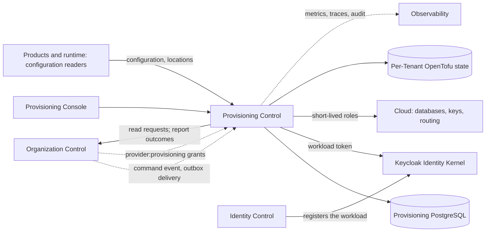
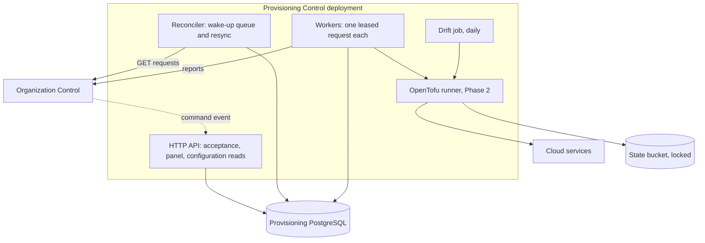
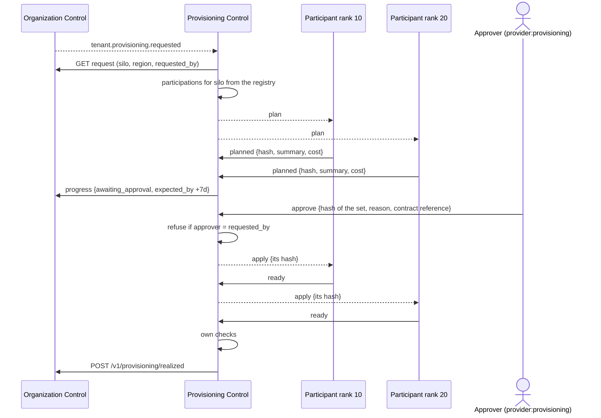

---
doc_meta:
  id: SAD-021
  title: Scnehaux Provisioning Control
  owner: Platform Engineering
  version: 1.3.0
  status: approved
  classification: public
  governed_by:
    - GDC-009
    - ADR-PRV-001
  review_cycle_days: 90
  created_date: 2026-11-04
  last_reviewed: 2026-11-12
  parent_pad: PAD-PLT-017
---

# Scnehaux Provisioning Control

## 1. Purpose & Scope

### Objective

Realise `PAD-PLT-017` with one service that turns each provisioning request from Organization Control into realised infrastructure and configuration, and reports the outcome, with no person reporting `realized` in normal operation, in production or in development.

### Capability

- reads outstanding provisioning requests and reconciles them (`ADR-PRV-001`);
- coordinates every platform that stores Tenant data as a registered participant, which provisions, checks, disables and destroys its own part (`ADR-PRV-006`);
- builds pooled Tenants directly and dedicated Tenants through approved OpenTofu plans (`ADR-PRV-003`);
- runs each profile's health checks before it reports (`PAD-PLT-017 §3.4`);
- holds dedicated plans for approval (`ADR-PRV-002`);
- deprovisions in three stages and destroys by key (`ADR-PRV-005`);
- detects drift;
- serves the provisioning panel for failed, stuck and waiting requests (§5.5).

### Requirement

Replace `scripts/dev-provisioning.ps1` and `scripts/dev-deprovisioning.ps1` as the source of provisioning outcomes, first in development (Phase 1, pooled), then for every profile (Phase 2), before the first non-pooled Tenant.

### Constraint

- Go is the application language; PostgreSQL is the service's store (`ADR-PRV-003`).
- It shares no database with Organization Control and Organization Control holds none of its cloud credentials (`ADR-PRV-004`).
- It authenticates as its own registered workload (`ADR-ORG-001 §5.11`).
- Desired state comes only from Organization Control.
- The running development deployment keeps `dev-provisioning.ps1` until Phase 1 is merged and the owner redeploys.

### Assumption

- Organization Control serves the Phase 1 additions of §7.1 before this service's Phase 1 runs.
- Production runs on the adopted cloud and Kubernetes, with workload identity to cloud roles.
- The provider grant model of `ADR-ORG-002` can be extended to `provider:provisioning`.

### Out of Scope

- Tenant lifecycle, activation, offboarding obligations and retirement (`SAD-004`);
- Product data and its deletion in shared stores;
- the shared platform's clusters, networks and shared databases;
- the user interface of the panel, which is the Provisioning Console, a separate deployable unit with its own SAD (§5.5).

## 2. Enterprise Traceability

### Realizes

This system realises `PAD-PLT-017` and the decisions `ADR-PRV-001` to `ADR-PRV-005`.

It inherits:

- the request and report contract from `SAD-004 §7.5` and `ADR-ORG-001 §5.11`;
- the provider grant model from `ADR-ORG-002`;
- per-consumer outbox delivery from `ADR-GLB-016` and `ADR-GLB-018`;
- environments, images and scripts from `STD-GLB-009`;
- retention from `STD-GLB-007`.

## 3. Solution Context

### System Context



### External

- Organization Control (`SAD-004`): requests, command event, grants, legal-hold flag, reports.
- Identity runtime (`SAD-001`): the service's workload client and the tokens of people using the panel.
- The cloud's database, key, secret and routing services.
- Products and runtime systems that read configuration and resource locations.

### Internal

1. **Provisioning Control application**: Go service with an HTTP API, the reconciler, workers, the drift job and the panel API.
2. **Provisioning PostgreSQL**: requests, plans, steps, leases, approvals, holds, configuration records, audit outbox.
3. **OpenTofu runtime**: the pinned binary and modules inside the service image, run in an isolated working directory per job (Phase 2).

## 4. Architecture Model

### 4.1 Container Architecture



### 4.2 Modules

| Module        | Responsibility                                                         |
| :------------ | :--------------------------------------------------------------------- |
| `intake`      | accepts the command event; enqueues a hint; never acts on the payload  |
| `reconcile`   | resync, request records, leases, deadlines                             |
| `profile`     | the plan of steps for each profile and each operation                  |
| `pooled`      | configuration and quota writes and their checks                        |
| `infra`       | OpenTofu plan, apply, drift; working directories; state (Phase 2)      |
| `health`      | the health checks of `PAD-PLT-017 §3.4` and `ADR-PRV-005 §5.3`         |
| `approval`    | plans awaiting approval, decisions, expiry (Phase 2)                   |
| `deprovision` | the three stages, holds, destruction (`ADR-PRV-005`)                   |
| `report`      | reports to Organization Control, resent until answered                 |
| `authority`   | workload authentication; projected `provider:provisioning` grants      |
| `config`      | configuration records and quota limits; reads for Products and runtime |

### 4.3 API Surface

```text
Organization Control only (its workload token)
POST /v1/deliveries                                  command event; answers 2xx once stored

Provider with provider:provisioning in force, X-Administrative-Reason required
GET  /v1/requests                                    ?state=&profile=&operation=&after=&limit=
GET  /v1/requests/{provisioning_request_id}
POST /v1/requests/{provisioning_request_id}/retry    a step-level retry inside the service
POST /v1/requests/{provisioning_request_id}/fail     report failed with a cause from the list
POST /v1/requests/{provisioning_request_id}/cleanup  remove what a failed build left
POST /v1/requests/{provisioning_request_id}/approve  Phase 2; plan hash and contract reference required
POST /v1/requests/{provisioning_request_id}/reject   Phase 2
POST /v1/tenants/{tenant_id}/destruction/hold        Phase 2
POST /v1/tenants/{tenant_id}/destruction/release-hold Phase 2

Registered configuration readers (workload tokens)
GET  /v1/tenants/{tenant_id}/configuration
```

No route here reports `realized` on a person's word. The only manual `realized` is the emergency break-glass of §5.5, made at Organization Control.

## 5. Runtime Flows

### 5.1 Pooled Tenant, No Person Involved

```mermaid
sequenceDiagram
    actor A as Provider administrator
    participant OC as Organization Control
    participant PC as Provisioning Control
    participant DB as Provisioning DB

    A->>OC: POST /v1/tenants (pooled)
    OC->>OC: Tenant requested + provisioning_request + outbox, one transaction
    OC-->>PC: tenant.provisioning.requested (identifiers only)
    PC->>DB: store hint
    PC->>OC: GET /v1/provisioning/requests (read the request)
    PC->>DB: request record + lease (unique on provisioning_request_id)
    PC->>DB: upsert configuration + quotas
    PC->>PC: health checks
    PC->>OC: POST /v1/provisioning/realized {correlation_id, detail}
    OC->>OC: request realized; Tenant requested -> provisioning
    A->>OC: activate (unchanged, a provider's act)
```

A duplicate event finds the request record and does nothing. A lost event is picked up by the resync within 60 seconds.

### 5.2 Silo Tenant, With Participants and Approval (Phase 2)



Each participant runs its own module with its own roles through the shared runner (`ADR-PRV-003`, `ADR-PRV-006 §5.1`).

### 5.3 Failure

A transient error retries with backoff and jitter (base 1 second, cap 60 seconds). A permanent error, or the service's deadline (pooled: 10 minutes from `requested_at`), stops retries. The service removes its own work and has every participant that did work clean up, in descending rank, and reports `failed` with a cause from the closed list of `ADR-PRV-001 §5.4`. The Tenant becomes `failed` in Organization Control, and a retry there is a new request with a new correlation identifier.

### 5.4 One Participant Fails or Is Silent

As `ADR-PRV-006 §5.4`: a participant that reports `failed` causes cleanup of every participant that did work, in descending rank, then `failed` with `participant_failed`. A participant silent past its deadline is `unresolved`; the others wait until its last deadline, then are cleaned up, the request is reported `failed` with `participant_unresolved`, and a cleanup obligation stays open for the silent one until it reports `cleaned`.

### 5.4.1 A Silent Service and `unresolved`

If the service is down or cannot reach Organization Control, nothing reports. Organization Control ages the request to `unresolved` after 30 minutes and raises its existing alerts. When the service returns, its resync reports the outcome of each `unresolved` request it holds, after checking the resources, and starts any it never saw (`ADR-PRV-001 §5.5`).

### 5.5 The Provisioning Panel

**The Provisioning Console (owner's decision, 4 November 2026).** The panel is a new console owned by this system, not a page in Organization Experience: a browser application and its back end, which calls §4.3's routes. It is a deployable unit of its own, so it gets its own SAD under `PAD-PLT-017` before Phase 2 builds it (`GDC-009 §2.1`), with its client registration through identity-control and the UI Platform packages as its design system. It shows:

| View               | Shows                                                                      | Actions                         |
| :----------------- | :------------------------------------------------------------------------- | :------------------------------ |
| Failed             | requests reported `failed`, with cause and steps                           | clean up partial resources      |
| Stuck              | requests past half their deadline, or `unresolved` in Organization Control | retry a step; fail with a cause |
| Awaiting approval  | plans with summary and cost (Phase 2)                                      | approve, reject                 |
| Recoverable window | deprovisioned Tenants and their destruction date                           | hold, release the hold          |

- Every action needs the scope `provider:provisioning` in force and a reason, and writes an audit row with the person's `principal_id`.
- **A destruction statement per Tenant** is available to a provider holding `provider:provisioning`: every participant's destruction record, for a customer or an auditor (`ADR-PRV-005 §5.5`).
- **Activation of `provider:provisioning`** is done in Organization Experience's activation panel, generalised to every eligible provider scope (owner's answer to question 11); this console only reads the grant.
- **There is no "mark realized" in the panel.** A person may fail a request, which never grants access, but not report one realised from the panel. If the service cannot finish a Tenant, the Tenant waits or fails.
- **Break-glass, for an emergency grant only (owner's decision, 4 November 2026).** From Phase 2, in production, Organization Control accepts a person's `POST /v1/provisioning/realized` only from a provider whose authority is an emergency grant (`ADR-ORG-002`); a provider acting under an activated eligible grant is refused. `failed` stays open to any provider in force.
  - _When._ Provisioning Control cannot finish a Tenant that must go live, and the person has run the profile's health checks of `PAD-PLT-017 §3.4` themselves.
  - _How._ The reason names the incident, each check run and its result. The report is recorded as a privileged access with the authority `emergency`.
  - _Review._ Every use alerts the Information Security Officer at once and is reviewed within 1 working day. When Provisioning Control is back, its resync runs the checks on that Tenant and raises a drift alert if any fails; it never reverses the report.
  - _Development._ The same rule; the stand-in scripts no longer report `realized` after Phase 1.
- "Start deprovisioning" in the brief is the **cleanup** action: it removes what a failed build left. Deprovisioning a live Tenant starts only from Organization Control's offboarding release.

### 5.6 Deprovisioning

```mermaid
sequenceDiagram
    actor P as Provider
    participant OC as Organization Control
    participant PC as Provisioning Control
    participant C as Cloud

    P->>OC: release (no open obligation, no legal hold)
    OC-->>PC: tenant.provisioning.requested (deprovision)
    PC->>OC: GET request (+ legal_hold)
    PC->>C: stage 1 disable: routing off, role off, key disabled
    PC->>PC: checks of ADR-PRV-005 §5.3
    PC->>OC: POST /v1/offboardings/{id}/deprovisioning realized
    Note over PC: stage 2: 30-day window; silo snapshot; key deletion scheduled
    PC->>OC: before stage 3, re-read legal_hold
    PC->>C: stage 3 destroy, unless held
```

## 6. State & Data Architecture

### 6.1 Storage

PostgreSQL, private to the service, with encrypted storage and point-in-time recovery in production.

| Schema          | Records                                                                                                |
| :-------------- | :----------------------------------------------------------------------------------------------------- |
| `request`       | request records, unique on `provisioning_request_id`; steps; leases; deadline; cause                   |
| `plan`          | saved plans, hashes, summaries, cost estimates (Phase 2)                                               |
| `approval`      | decisions; insert-only; 7 years (Phase 2)                                                              |
| `config`        | configuration records and quota limits per Tenant, versioned                                           |
| `resource`      | per-Tenant resource locations and key identifiers; destruction stage and date; holds                   |
| `participation` | participant registry; participations per request with state, plan hash, deadlines; cleanup obligations |
| `platform`      | inbox of hints, report outbox, audit outbox, idempotency keys                                          |

No cache holds desired state. The service is stateless between requests apart from its database.

### 6.2 Schema Rules

- The request record's key is Organization Control's `provisioning_request_id`, so a second hint cannot create a second record.
- A step's state changes only inside the transaction that holds the lease.
- Approval and audit tables refuse `UPDATE`, `DELETE` and `TRUNCATE` for every runtime role, as Organization Control's privileged-access record does.

### 6.3 Classification and Retention

As `PAD-PLT-017 §5.3`. Records of requests, approvals, holds and destruction are kept 7 years (`STD-GLB-007`) and are never purged with the Tenant.

## 7. Integration Contracts

### 7.1 Organization Control (Consumed and Published)

Existing, unchanged:

- `POST /v1/provisioning/realized`, `POST /v1/provisioning/failed`, `POST /v1/offboardings/{offboarding_id}/deprovisioning`, as the `provisioning` reporter.

Added in **Phase 1** (organization-control):

- `GET /v1/provisioning/requests` for the `provisioning` reporter, items with `provisioning_request_id`, `correlation_id`, `tenant_id`, `operation`, `desired_profile`, `state`, `requested_at`; for a deprovision item, also `offboarding_id` and `legal_hold`.
- The command event `com.scnehaux.organization.tenant.provisioning.requested`, written in the transaction of every `tenant.provisioning_request` row, delivered to a registered **provisioning target** (a new delivery kind, not a projection consumer).

Added in **Phase 2** (organization-control):

- `POST /v1/provisioning/progress {correlation_id, stage, expected_by}`; the sweep ages a request against `expected_by` when set, capped at 8 days.
- `requested_by` on each item of the read, for the approval check.
- `provider:provisioning` as a registered provider scope, projected to this service.
- In production, `POST /v1/provisioning/realized` from a person accepted only under an emergency grant, recorded with the authority `emergency` and alerted (§5.5).

### 7.1a Participants

The contract of `ADR-PRV-006 §5.2` and §5.3: a registry row per participant; commands `plan`, `apply`, `cleanup`, `disable`, `destroy`, `check` from this system's outbox to the participant's endpoint; reports to `POST /v1/participations/{participation_id}/report` with `planned`, `ready`, `cleaned`, `disabled`, `destroyed` or `failed` and a cause. Participants read their participation with `GET /v1/participations/{participation_id}`. Registration is `POST /v1/participants`, by a provider with `provider:provisioning` and a reason.

| Platform                                        | SAD              | Pooled                              | Bridge, silo, regional                                                                                                                                                                                                                                                |
| :---------------------------------------------- | :--------------- | :---------------------------------- | :-------------------------------------------------------------------------------------------------------------------------------------------------------------------------------------------------------------------------------------------------------------------- |
| Provisioning Control (configuration and quotas) | SAD-021          | its own work, not a participant     | its own work                                                                                                                                                                                                                                                          |
| Organization Control                            | SAD-004          | none                                | none: control plane, shared for every profile                                                                                                                                                                                                                         |
| Identity runtime                                | SAD-001          | none                                | none for `bridge` and `silo`: Tenants are not Realms (`ADR-ORG-001 §5.5`). Required for `regional`, through one identity deployment per region shared by its Tenants; designed in a separate ADR, and `regional` is refused until it is accepted (`ADR-PRV-006 §5.8`) |
| Notification                                    | SAD-005          | none                                | required: its per-Tenant store and key                                                                                                                                                                                                                                |
| Identity Experience, Organization Experience    | SAD-002, SAD-012 | none                                | none: no Tenant data at rest beyond sessions                                                                                                                                                                                                                          |
| Every later platform storing Tenant data        | its SAD          | declared there (`ADR-PRV-006 §5.9`) | declared there                                                                                                                                                                                                                                                        |

### 7.2 Products and Runtime (Published)

`GET /v1/tenants/{tenant_id}/configuration` for registered readers. A configuration change emits an event when a Product needs one; none does in Phase 1.

### 7.3 Events Published

Audit events for every report, approval, hold, step failure and destruction, through the service's audit outbox, in the enterprise envelope.

## 8. Security & Trust Boundary

### 8.1 Authentication

- Toward Organization Control: one workload client with a signed client assertion (`ADR-PRV-004 §5.1`).
- From Organization Control: its workload token, checked by `principal_id`.
- People: tokens with `aud` naming this service, through the panel's back end.
- Participants: each its own registered workload, admitted only for its own participations (`ADR-PRV-006 §5.3`).

### 8.2 Authorization

- Panel routes need `provider:provisioning` in force, read from the projected grant on each request.
- An approver cannot be the requester (`ADR-PRV-002 §5.3`).
- Configuration reads need a registered reader.

### 8.3 Secrets and Encryption

- The workload's private key and database credentials are in the environment's secret store; never in images, logs or the repository.
- Cloud access uses short-lived roles split into plan, apply and destroy, under a permission boundary (`ADR-PRV-004 §5.2`).
- State files are encrypted and locked; they may contain resource attributes and are treated as Tier 1 Restricted.

### 8.4 Threats

| Threat                            | Control                                                                  |
| :-------------------------------- | :----------------------------------------------------------------------- |
| A forged command event            | Accepted only from Organization Control's workload; and only a hint      |
| A replayed report                 | Organization Control answers a repeat as a replay                        |
| A plan changed after approval     | Apply runs only the saved plan whose hash was approved                   |
| A person declaring a Tenant built | No such route; `realized` refused for providers in production (Phase 2)  |
| The service's credentials stolen  | Short-lived roles; tagged resources only; cannot read Tenant data        |
| Organization Control compromised  | Holds no cloud credential; the service re-reads requests and checks them |
| Destruction by mistake            | 30-day window; holds; legal hold re-read before destruction              |

### 8.5 Audit

Every action records actor, Tenant, request, correlation, reason and result, kept 7 years.

## 9. NFR

### 9.1 Resilience & Failure Modes

| Failure                          | Effect                                     | Handling                                                                 |
| :------------------------------- | :----------------------------------------- | :----------------------------------------------------------------------- |
| Service down                     | No Tenant built; active Tenants unaffected | Organization Control ages to `unresolved`; resync on return              |
| Organization Control unreachable | Reports wait                               | Report outbox resends; requests continue                                 |
| Cloud API throttling             | Slower builds                              | Backoff with jitter; per-account concurrency cap                         |
| Crash during `tofu apply`        | State may stay locked                      | Worker resumes; a lock older than the job timeout is released by runbook |
| Health check fails               | Request fails                              | Compensation; `failed` with `health_check_failed`                        |
| Approval never given             | Request waits                              | Expires at 7 days with `approval_expired`                                |

Timeouts: each cloud call has its own timeout; each request has a deadline (pooled 10 minutes; dedicated `expected_by`). Retries use backoff with full jitter. A circuit breaker per cloud service stops new applies when its error rate passes 50% over 5 minutes.

### 9.2 Blast Radius

| Failure mode                     | Blast Radius                                                                                             |
| :------------------------------- | :------------------------------------------------------------------------------------------------------- |
| One request fails                | Single Tenant onboarding                                                                                 |
| Service outage                   | New Tenant onboarding and deprovisioning platform-wide; no active Tenant                                 |
| A bad module release             | Every Tenant planned with it, stopped at approval for dedicated profiles                                 |
| Leaked apply role                | Tagged provisioning resources in one account; no Tenant data readable                                    |
| Wrong destruction                | Single Tenant, recoverable for 30 days                                                                   |
| Leaked participant role          | That platform's tagged resources only; no other platform's data                                          |
| Provisioning Control compromised | No cloud write role over any platform's data; it can send commands, which participants re-read and check |

### 9.3 Observability & Operations

**Telemetry.** OpenTelemetry traces per request and step; metrics `provisioning_requests{profile,operation,state}`, `provisioning_request_age_seconds`, `provisioning_last_resync_success_timestamp`, `provisioning_drift_detected`, `provisioning_destruction_due_timestamp`.

**Alerting.**

| Alert                                 | Warning           | Critical                                                       |
| :------------------------------------ | :---------------- | :------------------------------------------------------------- |
| Request stuck (not finished)          | half its deadline | its deadline                                                   |
| Resync not succeeding                 | 2 intervals       | 5 intervals                                                    |
| Awaiting approval                     | 24 hours          | 6 days                                                         |
| Drift on a realised Tenant            | any               | —                                                              |
| Destruction overdue (per participant) | 1 day past window | 3 days, and a security incident is opened (`ADR-PRV-005 §5.5`) |
| Hold older than 30 days               | any               | —                                                              |

Organization Control's own alerts on stuck and `unresolved` requests stay and detect a silent service.

**Runbooks** (in the service's repository): stuck request; locked state; drift; mistaken release within the window; credential compromise.

## 10. Deployment Strategy

### 10.1 Environments

| Environment | Runs                                                                                                                | Status                     |
| :---------- | :------------------------------------------------------------------------------------------------------------------ | :------------------------- |
| Development | Docker Compose stack in the service's `deploy/dev`, beside identity and organization stacks; pooled only in Phase 1 | Phase 1                    |
| CI          | Stack-level proof bringing up identity, organization and this stack                                                 | Phase 1                    |
| Production  | Kubernetes namespace; workload identity to cloud roles                                                              | Not built (`ISMS-004` R15) |

### 10.2 Infrastructure

Development differs from production only where stated in `ADR-PRV-003 §5.4`, `ADR-PRV-004 §5.4` and §10.4. No production deployment exists; nothing this design governs is in production.

### 10.3 CI/CD

The service's CI follows `STD-GLB-009`: unit and integration tests, the `deploy/dev` skeleton, image build pinned by digest and scanned on every change and daily. The stack-level proof lives in this repository, the most downstream one, and runs the acceptance tests of §13 on pull requests, `main`, daily and on dispatch.

### 10.4 Development Stand-ins for Keys and Databases (Phase 2)

The owner decided on 12 November 2026 (open question 5): open-source stand-ins in provisioning-control's development stack, and no LocalStack (`ADR-PRV-003 §5.4`, with its sources). Phase 1 needs neither.

**Keys: OpenBao Transit.**

- One OpenBao container in the development stack, pinned by digest (`STD-GLB-009` §Container Images), never in dev mode: file storage, and the `file` audit device writing to a file on its volume.
- Reachable only on the stack's internal network. It publishes no port and is never behind the tunnel.
- Per participant: its own Transit mount, a policy limited to that mount, and an AppRole that issues short-lived tokens. The root token is used for setup (mounts, policies, roles) and revoked after it; no root token exists while the stack runs.
- One Transit key per dedicated Tenant per participant, created and deleted by the participant's own module through the OpenTofu Vault provider. The module sets `deletion_allowed` only at stage 3 of `ADR-PRV-005`.

**Databases: PostgreSQL, with no superuser and no Docker socket.**

- `bridge`: one shared PostgreSQL container, a database per bridge Tenant.
- `silo`: a fixed pool of 2 PostgreSQL containers, defined in provisioning-control's development compose file. Each stands in for one Tenant's instance. The modules connect to each as a role with `CREATEDB` and `CREATEROLE` only, never a superuser, and create and drop the Tenant's database and roles inside it.
- The provisioning runner never holds the Docker socket. On the development server the socket is root on a host that also runs the identity stacks. That is why the silo containers are a fixed pool rather than created per Tenant.
- Development holds at most 2 dedicated Tenants at a time. `regional` stays refused (`ADR-PRV-002 §5.6`).
- Cost on the development server: OpenBao about 100 to 200 MB of memory, each PostgreSQL container about 55 to 100 MB at idle, against about 6 GB free on that server.

**Destruction evidence in development.** Each participant's destruction record (`ADR-PRV-005 §5.5`) holds, for its part:

- for a database: the `DROP DATABASE`, and a read of `pg_database` that no longer lists it;
- for a key: the deletion in OpenBao's audit log, and a decrypt of a canary ciphertext, encrypted under the key when the Tenant was provisioned, now failing.

A key deletion alone proves nothing about a database's data unless the participant encrypts that data with the key itself (envelope encryption). In production a silo key encrypts the instance's storage and snapshots, so the cloud's deletion of the key makes them unreadable (`ADR-PRV-005 §5.2`). In development the containers' disks are not encrypted with it. The Notification Platform, the one participant with dedicated work named so far, provisions its own per-Tenant store and key (`SAD-005` §Tenant Provisioning Participation), and does not yet state whether it encrypts the store's data with that key. Each participant's TDD states what it encrypts with its Tenant key, and its destruction record claims a key deletion as destruction of data only for that data.

**Unsealing after a restart.**

- OpenBao starts sealed. It is configured with the static key seal, which "configures OpenBao to use static keys provided alongside the configuration file" (`ADR-PRV-003` R15), so it unseals itself after a restart of its container or of the server, with nobody present. A manual unseal would leave provisioning stopped after every restart until the owner acted, for keys that hold no customer data.
- The seal key is 32 random bytes in one file on the server, created once there and kept like the stack's `keys/` directory: git-ignored, outside every image, readable by the server owner's account only, mounted read-only into the OpenBao container. The server owner holds it; it is never committed, pasted or sent. Its loss loses the stand-in keys (see Backups below), which development accepts. Production uses the cloud KMS and no static key.
- OpenBao asks that the choice be weighed: "Carefully evaluate use of Static Key Auto Unseal to see if its use meets the desired security properties" (R15). Its page calls the seal an Auto Unseal and does not describe restart behaviour, so Phase 2's acceptance restarts the container, then the server, and checks that OpenBao is unsealed with nobody acting.
- A sealed OpenBao raises an alert; it never stops provisioning silently. The container's health check runs `bao status`, whose "exit code reflects the seal status": `2 - sealed` (R16). A participant whose key service is sealed fails its step with that reason and never reports success, so the Tenant's request ages to `unresolved` and alerts (`SAD-004` §7.5). provisioning-control's alert rule fires on a sealed OpenBao after 5 minutes. Until alerts are delivered in development (`ISMS-005` T10), the daily server check of `STD-GLB-009` rule 13 (`ISMS-005` T49) also reads the seal status and opens a `scheduled-failure` issue for a sealed OpenBao.

**Backups.** OpenBao's storage volume is in no backup of the development server. A disk failure therefore loses the stand-in keys, and with them the encrypted test data of every dedicated development Tenant; development accepts that, because those Tenants hold no customer data and are provisioned again. With no backup holding a key, a key's deletion is final when OpenBao records it, and the destruction record claims destruction from that date. That holds only while the volume stays out of every backup: provisioning-control's backup scope excludes it, and before Phase 2 the server owner confirms that no backup of the whole host, or of the Docker volume directory, copies it. If one does, that backup holds every key it copied: the destruction record then states the date the last backup holding the key expires, and claims destruction only from that date. The silo and bridge database volumes follow the same rule for the data they hold.

**Differences from production, stated.**

| Concern                 | Production                                           | Development                                                                                                                                                                   |
| :---------------------- | :--------------------------------------------------- | :---------------------------------------------------------------------------------------------------------------------------------------------------------------------------- |
| Silo instance           | One managed instance per Tenant                      | One of a fixed pool of 2 containers                                                                                                                                           |
| Key deletion wait       | The KMS pending-deletion window of 7 to 30 days      | None in OpenBao; the 30-day window is kept by provisioning-control's schedule alone, and tests shorten it by configuration                                                    |
| Key material            | Cloud KMS keys                                       | Software keys held by OpenBao, not in hardware security modules                                                                                                               |
| Key disabled at stage 1 | The KMS key disabled (`ADR-PRV-005 §5.1`)            | A Transit key has no disabled state like a KMS key's; each participant's TDD states how it stops use of the key at stage 1 and how the check of `ADR-PRV-005 §5.3` reads that |
| Storage encryption      | Instance storage and snapshots under the Tenant key  | Local disks, not encrypted per Tenant                                                                                                                                         |
| Capacity                | As ordered                                           | At most 2 dedicated Tenants at a time                                                                                                                                         |
| Unsealing               | The KMS needs no unseal                              | OpenBao's static key seal, from a key file on the server that its owner holds                                                                                                 |
| Key backups             | The KMS keeps the key until its deletion window ends | OpenBao's volume is in no backup, so a deleted key is gone at once and a disk failure loses every stand-in key                                                                |

## 11. Architecture Decisions

### Governing

- `ADR-PRV-001` — reconciliation from desired state read from Organization Control.
- `ADR-PRV-002` — approval of the plan before dedicated resources.
- `ADR-PRV-003` — Go reconciler; OpenTofu for dedicated resources.
- `ADR-PRV-004` — workload identity and narrow cloud roles.
- `ADR-PRV-005` — deprovisioning window and destruction by key.
- `ADR-PRV-006` — each platform provisions its own part; this system coordinates.
- `ADR-ORG-001 §5.11` — reporter workloads, extended.

### Rejected

- A provisioning module inside Organization Control (`ADR-PRV-004` Alternative A).
- Crossplane and a workflow engine (`ADR-PRV-003` Alternatives A, B).
- Event payloads as desired state (`ADR-PRV-001` Alternative A).
- A manual "mark realized" in the panel (§5.5); the only manual path is the emergency break-glass at Organization Control.
- Approval in Organization Control (`ADR-PRV-002` Alternative A).

## 12. Compatibility Strategy

- The three existing report routes keep their paths, bodies and meaning.
- The additions in §7.1 are new routes, a new event type and a new delivery kind; no existing consumer receives the new event.
- Refusing provider authority on `realized` in production (Phase 2) changes behaviour for providers only. The development stand-in that used it is retired in Phase 1, and organization-control's runbook `provisioning.md` C changes in the same pull request.

## 13. Migration Strategy and Roadmap

### Phase 1 — The Service with the Pooled Path, in the Development Stack

1. **organization-control:** the read route, the command event, the provisioning-target delivery kind (§7.1 Phase 1), with tests and `TDD-organization-control-003` updated in the same pull request.
2. **provisioning-control (new repository):** the service with `intake`, `reconcile`, `pooled`, `health`, `report`, `authority`, `config`, and the participant registry and report route of §7.1a; `deploy/dev`; CI; `TDD-provisioning-control-001`.
3. **Registration:** a development workload `provisioning-control` registered through identity-control with its own key, a reporter row for `provisioning`, and a provisioning target. The owner runs the commands.
4. **Stack-level proof** in provisioning-control, running the acceptance tests:
   - a pooled Tenant reaches `realized` with no human action, with no participant called;
   - a duplicate event causes no second action;
   - a failure is reported `failed` with a cause;
   - a silent service yields `unresolved`;
   - the service cannot act without its workload credentials;
   - a test participant (a fixture service in the proof stack, registered by a row) with pooled work is called and its `ready` awaited; registered and removed without a change to the service's code.
5. **Retire the stand-ins from the deploy steps:** organization-control's `deploy-dev` and runbook stop running `dev-provisioning.ps1` and `dev-deprovisioning.ps1`; at most they stay as CI test fixtures for organization-control's own route tests. `ISMS-007 §Scripts` changes in the same pull request.
6. **Redeploy** by the owner. Until then the development server keeps `dev-provisioning.ps1`.

Exit: the acceptance tests pass on `main` and daily; no deploy step or runbook asks a person to report `realized`.

### Phase 2 — Bridge, Silo, Regional, Participants, Approval and Panel

1. organization-control: progress report, `requested_by`, `provider:provisioning`, `realized` from a person only under an emergency grant (§7.1 Phase 2).
2. provisioning-control: the participant runner (library and image), `approval` over the set of participant plans, `deprovision`, drift, the panel API.
3. Each participating platform with dedicated work (Notification first, §7.1a): its OpenTofu module, its roles, its readiness check, its registry row, the runner in its deployment.
4. The Provisioning Console, with its own SAD first. Activating an eligible `provider:provisioning` grant needs an activation surface; open question 11 proposes the generalised activation panel in Organization Experience.
5. Development stand-ins for databases and keys: OpenBao and the PostgreSQL containers of §10.4.
6. Acceptance:
   - one participant's OpenBao token cannot delete another participant's key;
   - a silo Tenant is built only after approval of the set of plans by someone other than the requester; a rejected set creates nothing;
   - one participant fails while another succeeds: the one that succeeded is cleaned up, and the request is `failed` with `participant_failed`;
   - one participant is silent past its deadline: the request waits to the last deadline, the others are cleaned up, the request is `failed` with `participant_unresolved`, and the cleanup obligation stays open until the silent one reports `cleaned`;
   - a platform added later is registered by a row and takes part in the next silo Tenant with no change to provisioning-control's code;
   - deprovisioning reports `realized` only after every participant reports `disabled`; destruction waits for the window and any hold, and completes only when every participant reports `destroyed`.

Exit: Phase 2 is complete before the first non-pooled Tenant is requested.

## 14. Alternatives

The alternatives are in each ADR's §8. The overall choice, a separate service rather than a module of Organization Control, rests on credential separation (`ADR-PRV-004` Alternative A) and on `ADR-GLB-009`'s rule that repository boundaries follow security and release cohesion.

## 15. Open Questions for the Owner

Every question is answered. Questions 1 to 4 and 6 to 13 were answered on 4 and 10 November 2026, question 13 changed by the owner on 10 November before ratification; questions 10 to 13 came from the server agent's review of 4 November. Question 5, a Phase 2 entry decision, was answered on 12 November 2026 from the server agent's recommendation, with the owner's conditions (§10.4).

| #   | Question                                                                                                                                                                                                                                                                                              | Recommendation                                                                                 | Owner's answer                                                                                                                                                                                                                                      |
| :-- | :---------------------------------------------------------------------------------------------------------------------------------------------------------------------------------------------------------------------------------------------------------------------------------------------------- | :--------------------------------------------------------------------------------------------- | :-------------------------------------------------------------------------------------------------------------------------------------------------------------------------------------------------------------------------------------------------- |
| 1   | Create a new public repository `provisioning-control` for the service?                                                                                                                                                                                                                                | Yes; Phase 1 cannot start without it                                                           | Yes. The owner creates it                                                                                                                                                                                                                           |
| 2   | Which role holds `provider:provisioning` and approves dedicated plans?                                                                                                                                                                                                                                | Platform Engineering lead; never the requester                                                 | Platform Engineering lead (`ADR-PRV-002 §5.3`). While one person holds most roles (`ISMS-004` R19), no non-pooled Tenant can be approved                                                                                                            |
| 3   | Keep any break-glass way to report `realized` by hand?                                                                                                                                                                                                                                                | No                                                                                             | Yes, for an emergency grant only, defined in §5.5                                                                                                                                                                                                   |
| 4   | OpenTofu as the infrastructure tool, at radar `trial`?                                                                                                                                                                                                                                                | Yes, over Crossplane                                                                           | Yes (`ADR-PRV-003`, accepted; radar `trial`)                                                                                                                                                                                                        |
| 5   | The development stand-in for KMS and databases in Phase 2: LocalStack paid plan, or open-source stand-ins?                                                                                                                                                                                            | Decide before Phase 2; open-source if it covers key deletion                                   | Open source, no LocalStack: OpenBao Transit, not in dev mode, a mount, policy and AppRole per participant; PostgreSQL with a fixed pool of 2 silo containers and no superuser; the runner never holds the Docker socket (§10.4, `ADR-PRV-003 §5.4`) |
| 6   | Is a 30-day recoverable window right, given customer contracts? Pooled and bridge data stays in shared backups until they expire                                                                                                                                                                      | 30 days, and state the shared-backup period in contracts                                       | 30 days; the shared-backup period goes into customer terms (`ADR-PRV-005`, accepted)                                                                                                                                                                |
| 7   | Does activation stay a provider's act after a pooled Tenant is realised?                                                                                                                                                                                                                              | Yes. Activation is Organization's decision, not a build result                                 | Yes, a provider's act                                                                                                                                                                                                                               |
| 8   | Which console hosts the panel?                                                                                                                                                                                                                                                                        | Organization Experience, where providers already manage Tenants                                | A new console, owned by this system (§5.5)                                                                                                                                                                                                          |
| 9   | Does the Architecture Authority read `STD-GLB-009`'s Git-declared resources as satisfied by modules in Git with run-time inputs?                                                                                                                                                                      | Yes                                                                                            | Yes, by accepting `ADR-PRV-003`                                                                                                                                                                                                                     |
| 10  | Each platform provisions its own part, and Provisioning Control coordinates (`ADR-PRV-006`), instead of one central builder?                                                                                                                                                                          | Yes, with a shared runner and per-platform roles                                               | Yes, per platform (`ADR-PRV-006`)                                                                                                                                                                                                                   |
| 11  | The owner chose a new console for the provisioning panel (question 8); the server agent proposed Organization Experience. Keep the new console for the panel, and activate `provider:provisioning` grants through Organization Experience's activation panel (#31) generalised to any eligible scope? | Yes, both: one activation panel for every scope, and the provisioning panel in its own console | Both: activation in Organization Experience's generalised panel; the provisioning panel in the Provisioning Console                                                                                                                                 |
| 12  | Deprovisioning: the Tenant may be retired once every participant has disabled its part, while destruction is confirmed 30 days later; or retirement waits for every participant's destruction?                                                                                                        | Retire after disable; destruction is tracked and alerted in Provisioning Control               | Retire after every participant has disabled its part. A destruction overdue by 3 days is an incident, and each participant keeps evidence of its destruction for a destruction statement (`ADR-PRV-005 §5.5`)                                       |
| 13  | Does a regional Tenant need identity data in its region, making identity a participant for `regional`?                                                                                                                                                                                                | Decide with the first regional customer                                                        | Yes: one identity deployment per region, shared by its Tenants, not a Realm per Tenant. Detailed in a separate ADR at the first regional customer; until it is accepted, `regional` is refused (`ADR-PRV-006 §5.8`, `ADR-PRV-002 §5.6`)             |
